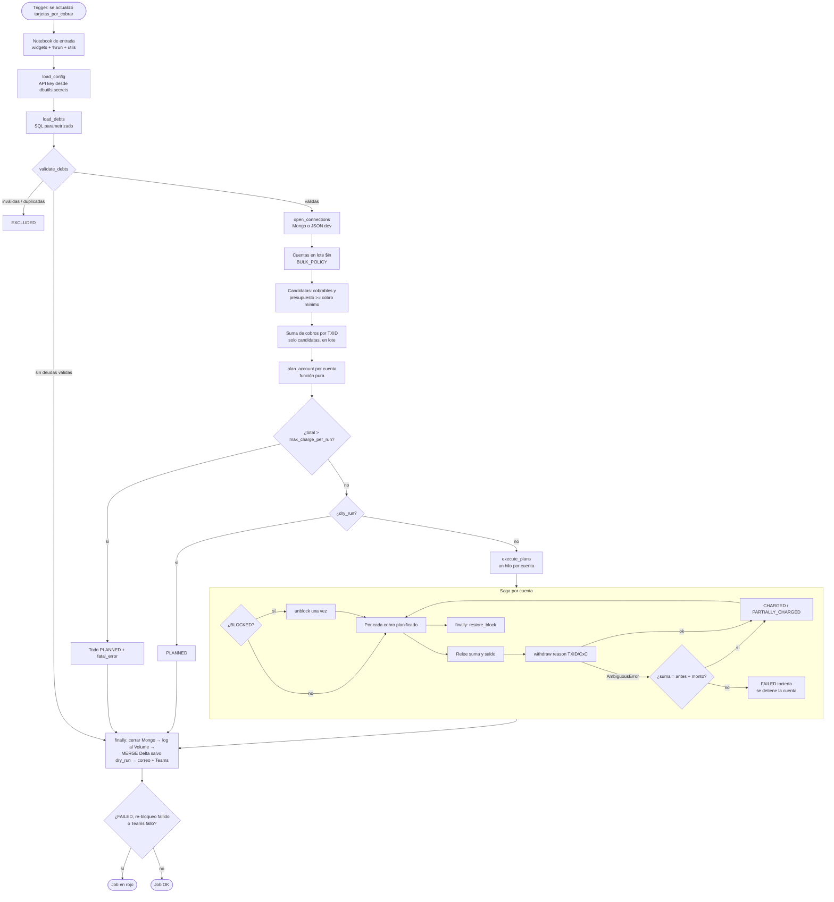

# emv-debt-collection

Cobro diario de deuda EMV sobre Databricks. Reemplaza al notebook único `emv_debt_collection` **sin cambiar su
lógica**: mismas reglas, mismo orden de pasos, mismos reintentos, mismos mensajes y mismo esquema Delta.

## Qué hace

1. Lee las deudas pendientes de la tabla origen (`tarjetas_por_cobrar`) con SQL parametrizado:
   `MONTO_DEUDA_RESTANTE > 0` y `FECHA_LIQUIDACION <= run_date - 14 días`.
2. Valida cada fila en el borde (montos enteros no negativos, `CLP_AUTORIZACIONES = MONTO_COBRADO_PARCIAL +
   MONTO_DEUDA_RESTANTE`, TXID sin `/`, TXID no duplicado). Lo inválido queda `EXCLUDED`.
3. Lee las cuentas en Mongo en lote (`$in` por bloques) y, solo para las candidatas, suma lo ya cobrado por deuda
   agrupando por el TXID del `metadata.reason` (`<TXID>/CxC` o `<TXID>/GO-445/CxC`).
4. Planifica por cuenta (función pura): presupuesto `min(saldo, tope por cuenta)`, deudas en orden
   fecha → mayor monto → TXID, cobro `min(lo que falta, presupuesto)` con cobro mínimo configurable.
5. Si el plan supera el tope por ejecución, no cobra nada (circuit breaker).
6. Ejecuta en paralelo por cuenta (un hilo = una cuenta): desbloquea una vez si estaba BLOCKED, relee suma y saldo
   antes de cada débito, retira con `POST accounts/fund/manual` y **siempre** re-bloquea en `finally`.
7. Persiste en Delta (`runs` y `results`, MERGE idempotente) y notifica por correo y Teams.

En `dry_run` no se llama a la API ni se escribe en Delta.

## Arquitectura

Arquitectura hexagonal liviana: el dominio no conoce Mongo, Spark ni HTTP; la aplicación orquesta sobre
`Protocol`s; los adaptadores implementan esos puertos; el composition root los conecta.

```
src/emv_debt_collection/
├── config.py           Config inmutable, EnvSettings, load_config (bloqueo de JSON fuera de dev), MONGO, WITHDRAW
├── shared.py           CHILE_TZ, now, describe, chunks, clp
├── logging_setup.py    ChileanFormatter, setup_logging
├── ports.py            Protocols: repositorio, API, origen, store, notifier, log, dependencias corporativas
├── composition.py      Composition root: open_connections, run_job (lo llama el notebook)
├── domain/             models, errors, reasons, planning (puro)
├── application/        retry, planner, executor (Saga), run (main)
└── adapters/           source_table, mongo_repo, backoffice_api, delta_store, notifier, log_publisher, dev_json
notebooks/run_emv_debt_collection.py   entrada delgada: widgets + %run corporativo + inyección + display
```

| Patrón | Dónde |
|---|---|
| Repository | `adapters/mongo_repo.py` (`MongoRepo`), `adapters/dev_json.py` (`JsonStore` hereda y solo cambia el acceso crudo) |
| Decorator | `mongo_call` (PyMongoError → `TransientError`), `MirroredApi` (API real + reflejo en JSON) |
| Composition root | `composition.py` (`open_connections`, `run_job`) |
| Plan-then-execute | `domain/planning.py` (`plan_account` puro) → `application/executor.py` |
| Saga con compensación | `execute_account`: re-bloqueo en `finally` (`restore_block`) |
| Circuit breaker | `check_run_limits` (tope por ejecución) |
| Taxonomía de errores | `domain/errors.py`: `TransientError` / `AmbiguousError` / `BusinessError` |
| Retry con backoff + jitter | `application/retry.py` (`RETRY`, `VERIFY`, `REBLOCK`, `BULK`) |

Dependencias corporativas que **no** están en este repo y se inyectan desde el notebook:
`conectar_mongo` / `desconectar_mongo` (del `%run "/Workspace/Procesos_Automaticos/Funciones/Funciones_Conexion_MongoDB_MI"`)
y `send_email` / `send_message` (módulo `utils`).

## Flujo



## Dependencia de la tabla origen (obligatoria)

El job **debe** correr después de que `tarjetas_por_cobrar` se actualiza. La idempotencia exige que lo cobrado en
Mongo para cada deuda sea **igual** a `MONTO_COBRADO_PARCIAL`. Si el job corriera antes de la actualización, los
cobros hechos desde la última carga estarían en Mongo pero no en la tabla. Esas deudas quedarían `EXCLUDED` con
"hay cobros posteriores a la actualización de la tabla". Nunca se cobra de más, pero ese día no se cobra nada de ellas.

La tabla la actualiza un pipeline de Databricks que solo corre cuando su job upstream termina con éxito. Por eso
este job usa un **trigger `table_update`** sobre `source_table`, configurable con variables del bundle:

| Variable | Default | Uso |
|---|---|---|
| `trigger_pause_status` | `UNPAUSED` | En `dev`, el modo development lo pausa siempre |
| `trigger_wait_after_last_change_seconds` | `900` | Agrupa varias escrituras del mismo pipeline en un solo disparo |
| `trigger_min_time_between_triggers_seconds` | `3600` | Evita ejecuciones seguidas si la tabla se reescribe |

Alternativa si se prefiere acoplar explícitamente: quitar el `trigger` y agregar al job upstream una tarea
`run_job_task` (con `run_if: ALL_SUCCESS`) que apunte al `job_id` de este job (`databricks bundle summary -t prod`).

## Configuración

`config.py` mantiene los parámetros de negocio (`settlement_days`, topes, `min_charge_amount`, `max_workers`,
`http_timeout`, `mongo_batch_size`, `origin`) con los mismos valores del notebook. Todo lo que cambia entre
ambientes o no debe estar en el repo llega como **parámetro del job** desde variables del bundle:

| Variable del bundle | GitHub Environment variable | Descripción |
|---|---|---|
| `existing_cluster_id` | `EXISTING_CLUSTER_ID` | Cluster existente DBR 15.4 LTS con pymongo |
| `service_principal_application_id` | `SERVICE_PRINCIPAL_APPLICATION_ID` | `run_as` en prod |
| `failure_notification_email` | `FAILURE_NOTIFICATION_EMAIL` | Notificación nativa del job al fallar |
| `api_base_url` | `API_BASE_URL` | URL base del backoffice |
| `api_key_scope` / `api_key_name` | `API_KEY_SCOPE` / `API_KEY_NAME` | Secreto de la API key |
| `mongo_connection` / `mongo_secret` | `MONGO_CONNECTION` / `MONGO_SECRET` | Argumentos de `conectar_mongo` |
| `source_table` | `SOURCE_TABLE` | Tabla de deudas (y tabla que dispara el job) |
| `tables_schema` | `TABLES_SCHEMA` | `catalogo.schema` de `<env>_emv_debt_collection_runs/_results` |
| `operator_user` | `OPERATOR_USER` | Usuario de auditoría en la API |
| `logs_dir` | `LOGS_DIR` | Carpeta dentro del Volume de logs |
| `email_recipients` | `EMAIL_RECIPIENTS` | **Un** string (se pasa tal cual a `send_email`) |
| `teams_chat_id` | `TEAMS_CHAT_ID` | Chat de Teams |
| `utils_path` | `UTILS_PATH` | Opcional: carpeta del módulo `utils` si no está en el `sys.path` |
| `dev_json_accounts` / `dev_json_transactions` | `DEV_JSON_ACCOUNTS` / `DEV_JSON_TRANSACTIONS` | Solo dev: modo JSON |

`dry_run` vale `"true"` en dev y `"false"` en prod (target). Una ejecución manual del notebook sin parámetros usa
`dry_run=true`. `run_date` vacío significa hoy en hora de Chile.

### Modo dev con JSON

Si `dev_json_accounts` viene informado, `open_connections` usa `JsonStore` + `MirroredApi`: lee cuentas y
transacciones de exports JSON, llama a la API real de dev y refleja cada efecto exitoso de vuelta en los JSON.
`load_config` lanza error si eso ocurre fuera de dev: **prod siempre lee Mongo**.

## Despliegue

### Bundle (job, wheel y notebook)

`databricks.yml` construye el wheel (`dynamic_version: true` para que el cluster existente no reutilice uno
cacheado) y despliega el notebook y el job (`resources/emv_debt_collection.job.yml`):
`max_concurrent_runs: 1`, `max_retries: 0`, parámetros `env`/`dry_run`/`run_date` y la notificación nativa por correo.

Se despliega con el workflow **deploy** (`workflow_dispatch` → target `dev` o `prod`). `prod` solo corre desde
`main` y requiere aprobación del GitHub Environment `prod`.

### Terraform (`infra/terraform`)

Solo lo que el bundle no cubre, sin duplicar el job:

- Volume de logs (`databricks_volume`, `prevent_destroy`).
- Secret scopes: **solo su existencia** (`databricks_secret_scope`, `prevent_destroy`) y `READ` para el principal
  del job (`databricks_secret_acl`). Los valores se cargan con `databricks secrets put-secret`.
- Grants no autoritativos (`databricks_grant`): `USE_CATALOG`, `USE_SCHEMA`, `SELECT` en la tabla origen,
  `CREATE_TABLE` en el schema de resultados y `READ_VOLUME`/`WRITE_VOLUME` en el volume.

Queda **fuera** a propósito:

- Las tablas `runs` y `results`: las crea y evoluciona el código (`ensure_tables`).
- El permiso del principal sobre el cluster existente: `databricks_permissions` es autoritativo y borraría los
  ACL de los demás usuarios del cluster. Se otorga a mano (`CAN_RESTART` o `CAN_ATTACH_TO`).
- El service principal y los GitHub Environments.

El estado vive en una storage account de Azure (`backend "azurerm"`). El volume y los scopes ya existen y son
compartidos, así que **se importan antes del primer apply**:

```bash
cd infra/terraform
cp backend.hcl.example backend.hcl            # completar
cp terraform.tfvars.example terraform.tfvars  # completar
terraform init -backend-config=backend.hcl
terraform import databricks_volume.logs '<catalogo>.<schema>.<volume>'
terraform import 'databricks_secret_scope.this["<scope>"]' '<scope>'   # uno por scope
terraform plan    # debe mostrar solo grants y ACLs nuevos, sin cambios destructivos
terraform apply
```

## Operación

- **Ejecución manual segura**: abrir el job → *Run now with different parameters* → `dry_run=true`. Se
  planifica todo, se notifica y no se cobra ni se escribe en Delta.
- **Detalle de una ejecución**:
  `SELECT * FROM <tables_schema>.<env>_emv_debt_collection_results WHERE run_id = '<run_id>'`.
- **Job en rojo** cuando: el estado es `FAILED`, alguna cuenta quedó desbloqueada (re-bloqueo fallido) o falló
  Teams. El correo lista los casos críticos (cuenta desbloqueada, cobro incierto, posible sobrecobro).
- **Cobro incierto** (`FAILED` con respuesta ambigua no conciliada): no se cobra más de esa cuenta en la
  ejecución. Si el cobro aparece después, el pipeline lo suma a `MONTO_COBRADO_PARCIAL`.
- **Reejecutar un día pasado**: `run_date=YYYY-MM-DD` fija el mismo corte. El MERGE por `run_id` es idempotente.
- **Logs**: cada ejecución copia su log a `logs_dir` (`log_file` en la tabla `runs`).

## Desarrollo

```bash
python -m venv .venv && .venv/Scripts/activate      # Python 3.11
pip install -e ".[dev]"
pre-commit install
ruff check . && ruff format --check . && mypy && pytest
```

Los tests corren sin Databricks, sin Mongo real y sin red: Mongo con `mongomock`, la API con `responses` (callbacks
que simulan el backend sobre la misma base), Spark/Delta con un store en memoria detrás del mismo `Protocol`,
`dbutils` y notificaciones con fakes, y los reintentos sin esperas reales.

| Suite | Qué cubre |
|---|---|
| `unit/test_plan_account.py` | Asignación parcial y orden, tope por cuenta, cobro mínimo |
| `unit/test_debt_id_from_reason.py` | Formatos válidos e inválidos; `a1` no calza con `a10` |
| `unit/test_collected_mismatch.py` | Exclusión con Mongo con menos, con más y sobre el original (`overcharged`) |
| `integration/test_blocked_account_charge.py` | Cuenta BLOCKED: un desbloqueo, cobro total + parcial, re-bloqueo, store |
| `integration/test_ambiguous_withdraw.py` | Timeout de lectura aplicado → conciliación por suma, un solo retiro |
